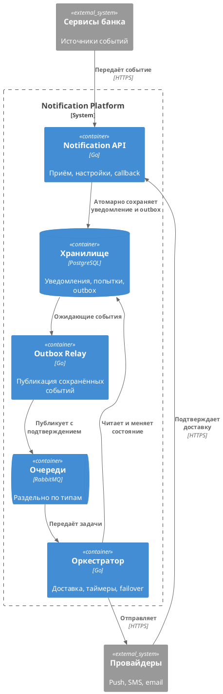
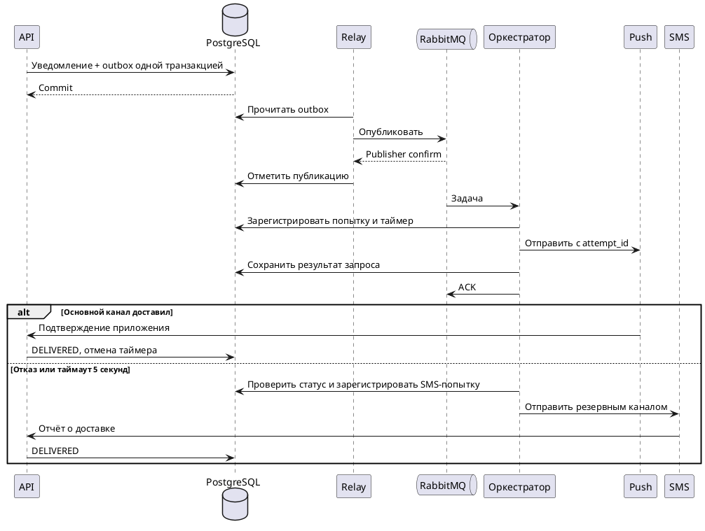
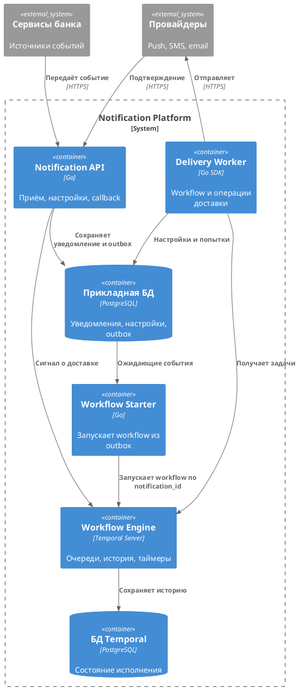
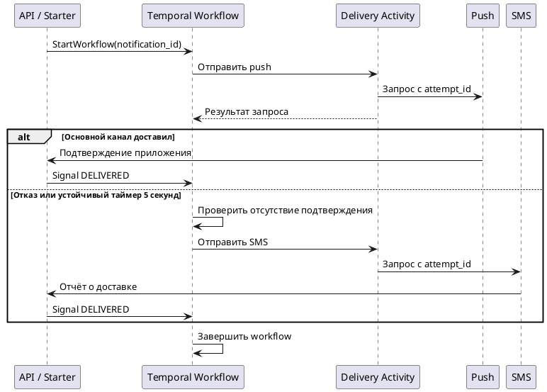

## Требования и архитектурное мышление

**Система:** централизованная платформа уведомлений онлайн-банка (Notification Platform).

## 1. Функциональные требования

| ID | Требование |
| --- | --- |
| F1 | Все команды банка отправляют уведомления через единую платформу |
| F2 | Платформа поддерживает push, SMS и email |
| F3 | Транзакционные уведомления обслуживаются раньше сервисных и маркетинговых |
| F4 | Пользователь может отключить маркетинговые и необязательные сервисные уведомления Транзакционные отключать нельзя |
| F5 | Пользователь может выбрать предпочтительный канал При недоставке система использует резервный |
| F6 | Повторная передача одного события не должна создавать новое уведомление |
| F7 | Сотрудник банка может проверить статус уведомления и причины недоставки |
| F8 | Платформа поддерживает кампании до 1 млн получателей и ограничивает маркетинг тремя сообщениями в неделю на пользователя |

## 2. Нефункциональные требования

Числа ниже — проектные целевые значения. p99 означает, что требование выполняется для 99% запросов.

| ID | Требование |
| --- | --- |
| N1 | Первая попытка транзакционной отправки: p99 ≤ 2 с от фиксации банковской операции |
| N2 | Не менее 99,9% критичных уведомлений получают подтверждение доставки за 60 с в течение месяца |
| N3 | Доступность приёма запросов — не менее 99,99% в месяц |
| N4 | Система выдерживает 10 000 новых уведомлений/с и до 20 000 попыток доставки/с с учётом повторов |
| N5 | Кампания на 1 млн пользователей обрабатывается за ≤ 15 минут без нарушения N1 |
| N6 | При отказе одной зоны доступности принятые сообщения не теряются: RPO = 0, RTO ≤ 60 с |
| N7 | Повторный запрос с тем же ID не создаёт новое уведомление в течение 30 дне |
| N8 | Все переходы статуса журналируются; история хранится 30 дней. Данные шифруются при передаче и хранении |

N2 измеряется для уведомлений с действующими контактами. Сбои провайдеров учитываются как недоставка. RPO = 0 означает отсутствие потери принятых данных, RTO ≤ 60 с — восстановление работы не более чем за минуту.

## 3. Архитектурно значимые требования (ASR)

Приоритеты: P0 — обязательное, P1 — важное

| ASR | Приоритет | Связанные требования | Влияние на архитектуру |
| --- | --- | --- | --- |
| A1. Быстрая доставка критичных сообщений | P0 | F3, N1, N5 | Нужны отдельные ресурсы для критичного потока. |
| A2. Сохранность и восстановление доставки | P0 | F5, F7, N2, N3, N6 | Нужны устойчивое состояние, резервирование и автоматическое переключение. |
| A3. Защита от повторной отправки | P0 | F6, N7 | Нужны уникальные ID и согласованное управление попытками. |
| A4. Масштабирование и контроль затрат | P1 | F4, F8, N4, N5 | Нужны параллельная обработка, ограничения нагрузки и экономный выбор каналов. |

## 4. Ключевые архитектурные вопросы

| Вопрос | Основание | Почему важен |
| --- | --- | --- |
| Как изолировать транзакционные сообщения от массовых кампаний? | A1, A4 | Кампания не должна задерживать подтверждение перевода. |
| Где хранить состояние доставки и таймеры? | A2 | После перезапуска обработка должна продолжиться. |
| Когда переключаться на резервный канал? | A1–A3 | Раннее переключение увеличивает дубли и стоимость, позднее задержку. |
| Что считать доставкой? | A2 | Приём запроса провайдером ещё не означает получение уведомления. |

## 5. Архитектурные последствия ASR

| ASR | Последствия |
| --- | --- |
| A1 | Раздельные очереди и обработчики по типам уведомлений; резерв мощности для транзакций. |
| A2 | Репликация, постоянное хранение состояния, повторы, таймеры и резервные провайдеры. |
| A3 | Идемпотентность, уникальные ограничения в БД и атомарные переходы состояния. |
| A4 | Горизонтальное масштабирование, ограничение скорости кампаний и push перед SMS по умолчанию. |

## 6. Архитектурные решения, которые не подходят

| Решение | Нарушаемый ASR | Причина |
| --- | --- | --- |
| Одна FIFO-очередь для всех уведомлений | A1 | Миллион маркетинговых сообщений задержит транзакционные. |
| Хранение состояния доставки только в памяти | A2 | После перезапуска потеряются попытки и таймеры. |
| Одновременная отправка во все каналы | A3, A4 | Возникают лишние дубли и расходы на SMS. |

## 7. Неопределённости и архитектурные риски

| Неизвестно | Как проверить |
| --- | --- |
| Реальная пиковая нагрузка | Собрать статистику банковских событий и провести нагрузочный тест. |
| Задержки и точность подтверждений провайдеров | Провести пилот, измерить p95/p99 и долю отсутствующих подтверждений. |
| Поддержка идемпотентности провайдерами | Проверить API и повторные запросы в тестовой среде. |
| Доля пользователей без доступных контактов | Проверить качество телефонов, email и push-токенов. |

## 8. RFC: доставка критичных уведомлений с автоматическим переключением каналов

**Статус:** предложено.  
**Область:** транзакционные уведомления.  
**Выбранное решение:** вариант 1 — RabbitMQ и PostgreSQL.

### 8.1. Контекст и проблема

Независимая отправка разными командами приводит к задержкам, дублям и отсутствию контроля. Нужен единый механизм, который продолжает обработку после сбоев и переключает каналы при недоставке.

### 8.2. Цели и границы

Цели: выполнить A1–A4, автоматически восстанавливать доставку и уменьшить расходы на SMS.

Вне области RFC: сегментация маркетинга и выполнение банковских операций.

**Граница гарантии:** принятое уведомление сохраняется и обрабатывается до подтверждения либо передачи на ручное разбирательство. Доставка пользователю невозможна, если все каналы недоступны. Прочтение сообщения не гарантируется.

Подтверждение доставки:

- push — подтверждение приложения;
- SMS — отчёт о доставке на устройство;
- email — подтверждение принимающего почтового сервера.

Простой ответ провайдера «запрос принят» доставкой не считается.

### 8.3. Требования и приоритеты

Используются F1–F8, N1–N8 и A1–A4 из разделов 1–3.

Дополнительные требования:

- уведомление получает единый `notification_id`;
- отправки выполняются последовательно по каналам;
- при подтверждении любого канала дальнейшие попытки отменяются;
- неопределённый результат отправки сохраняется отдельно от явного отказа.

### 8.4. Масштаб системы и расчёт нагрузки

Исходные данные: MAU — 10 млн, DAU — 3 млн, одновременно активны до 300 000 пользователей. Дневной объём рассчитывается по DAU.

| Тип уведомления | На пользователя в сутки | Всего в сутки | В среднем в секунду |
| --- | ---: | ---: | ---: |
| Транзакционные | 2 | 6 млн | 69 |
| Сервисные | 3 | 9 млн | 104 |
| Маркетинговые | 5 | 15 млн | 174 |
| **Всего** | **10** | **30 млн** | **347** |

Средняя нагрузка: `30 000 000 / 86 400 ≈ 347 уведомлений/с`.

При пике ×10: около **3 470 уведомлений/с**.

Кампания на 1 млн за 15 минут: `1 000 000 / 900 ≈ 1 111 уведомлений/с`.

Совместно — около **4 580 уведомлений/с**. С двукратным запасом выбираем **10 000 новых уведомлений/с**. При двух попытках на сообщение — до **20 000 отправок/с**.

300 000 одновременных пользователей при одной операции за минуту дают всплеск порядка **5 000 событий/с**. Этот сценарий проверяется отдельным тестом; он не складывается автоматически с уже учтённым пиком ×10.

При размере записи 1 КБ получаем около **30 ГБ/сутки**, или **900 ГБ за 30 дней** без индексов и репликации. Нужны секционирование по дате и проверка производительности БД.

Расчёт маркетинга использует исходные 5 сообщений в день как верхнюю оценку входящего потока. Лимит F8 уменьшает фактическое число отправок.

### 8.5. Вариант 1: RabbitMQ и собственный оркестратор

**Технологии:** Go, RabbitMQ quorum queues, PostgreSQL, Kubernetes. Метрики — Prometheus/Grafana, трассировка — OpenTelemetry.

RabbitMQ хранит задачи в реплицируемых очередях. Используются подтверждения публикации (publisher confirms) и ручные подтверждения обработки (ACK). Они подтверждают обмен с брокером, но не доставку пользователю.

#### C4 Container

#### Основной сценарий и failover

Таймеры и результаты попыток хранятся в PostgreSQL. После падения обработчика другой экземпляр продолжает обработку просроченных попыток. Сообщение подтверждается брокеру после сохранения состояния, поэтому ожидание доставки не блокирует очередь.

### 8.6. Вариант 2: Temporal

**Технологии:** Go SDK, Temporal Server, PostgreSQL, Kubernetes. Внешний брокер не требуется: используются очереди задач Temporal.

На каждое уведомление создаётся workflow — сохраняемый процесс доставки. Temporal хранит историю выполнения и восстанавливает процесс после сбоев. Внешние отправки всё равно требуют идемпотентности.

#### C4 Container

#### Основной сценарий и failover

### 8.7. Выполнение ASR и сравнение решений

| ASR | Вариант 1 | Вариант 2 |
| --- | --- | --- |
| A1 | Отдельные очереди и обработчики | Отдельные очереди задач и workers |
| A2 | Репликация, outbox и сохранённые таймеры | Outbox, история workflow и устойчивые таймеры |
| A3 | Уникальные ID и атомарные переходы в БД | Уникальный workflow ID и идемпотентные activities |
| A4 | Масштабирование обработчиков и лимиты кампаний | Масштабирование workers и лимиты activities |

Оба варианта используют последовательный выбор каналов, поэтому SMS отправляется только при необходимости. Выполнение численных SLO проверяется нагрузочными тестами и пилотом.

| Критерий | Вариант 1 | Вариант 2 |
| --- | --- | --- |
| Сложность инфраструктуры | Ниже | Выше |
| Объём собственного кода | Больше | Меньше |
| Восстановление сценария | Реализуется самостоятельно | Поддерживается workflow engine |
| Изменение сложных цепочек | Сложнее | Удобнее |

**Выбор: вариант 1.** Последовательность из трёх каналов достаточно проста. RabbitMQ и PostgreSQL позволяют реализовать её без отдельной workflow-платформы. Цена выбора — собственная реализация таймеров и восстановления.

### 8.8. Политика доставки

1. Исключить недействительные контакты и недоступные каналы.
2. Использовать предпочтительный канал; по умолчанию — push → SMS → email.
3. При явном отказе переключиться сразу. При отсутствии подтверждения: push — через 5 с, SMS — через 20 с, email — через 30 с.
4. Перед каждой попыткой проверить, не получено ли подтверждение.
5. При подтверждённом отказе провайдера разрешить одну попытку через резервного провайдера, если хватает времени до переключения канала.
6. После обхода каналов повторять с интервалами 1, 5 и далее 15 минут. Через 60 с без доставки создать сигнал дежурному.
7. Через 24 часа передать случай на ручное разбирательство.

Таймаут канала отсчитывается от начала попытки. Таймаут запроса к провайдеру ограничивается оставшимся временем канала.

При неизвестном результате сначала запрашивается статус попытки. Провайдер с частыми ошибками временно исключается с помощью circuit breaker.

Транзакционные уведомления не отключаются. Пользователь задаёт предпочтительный канал среди доступных. Настройки маркетинга на транзакционные сообщения не распространяются.

### 8.9. Сохранность и предотвращение дублей

- Источник сохраняет событие вместе с банковской операцией через transactional outbox — таблицу событий, ожидающих отправки.
- Платформа отвечает об успешном приёме только после записи уведомления и своего outbox.
- Уникальность уведомления задаётся ключом `(source, event_id, recipient, notification_type)`.
- Каждая попытка имеет `attempt_id`; повтор запроса использует прежний ключ идемпотентности.
- Следующая попытка создаётся атомарно: только один обработчик может её зарегистрировать.
- Повторные callback обрабатываются идемпотентно.
- Позднее подтверждение переводит уведомление в `DELIVERED` и отменяет ожидающие попытки.

**Ограничение:** push может дойти после отправки SMS. Полностью исключить такой межканальный дубль нельзя. Приоритет отдаётся доставке; повторные запросы и параллельные отправки контролируются. Если провайдер не поддерживает идемпотентность и проверку статуса, абсолютная защита от повторной внешней отправки также невозможна.

Основные состояния:

| Состояние | Значение |
| --- | --- |
| `ACCEPTED` | Уведомление сохранено. |
| `SENDING` | Выполняется запрос на отправку. |
| `WAITING` | Ожидается подтверждение или время следующей попытки. |
| `DELIVERED` | Доставка подтверждена хотя бы одним каналом. |
| `ESCALATED` | Срок автоматической обработки исчерпан; требуется разбирательство. |

Основной переход: `ACCEPTED → SENDING → WAITING → DELIVERED`. При отказе создаётся следующая попытка. При исчерпании срока устанавливается `ESCALATED`.

### 8.10. Надёжность и безопасность

RabbitMQ размещается в трёх зонах доступности. PostgreSQL использует синхронную репликацию между зонами и автоматическое переключение. При потере кворума приём приостанавливается, чтобы не подтверждать несохранённые данные.

Для критичных сообщений выделяются отдельные ресурсы. Настройки проверяются перед отправкой; при их недоступности маркетинг приостанавливается. Критичная отправка использует последние подтверждённые настройки и доступные проверенные контакты.

Доступ сервисов ограничивается ролями. Callback проверяются по подписи и ID попытки. Секреты хранятся в Vault. Телефоны, email и содержимое сообщений маскируются в логах.

### 8.11. Наблюдаемость и стоимость

Основные метрики:

- задержка первой попытки и подтверждённой доставки;
- доля уведомлений, доставленных за 60 с;
- возраст сообщений в очереди;
- ошибки, повторы и переключения по каналам;
- доля SMS и стоимость успешной доставки.

Все события связываются через `notification_id`. Алерт создаётся при нарушении SLO или остановке обработки.

Для стандартного порядка каналов ожидаемая стоимость:

`C = N × (c_push + p_SMS × c_SMS + p_email × c_email)`,

где `N` — число уведомлений, `c` — стоимость отправки, `p` — вероятность перехода к каналу. Повторные попытки учитываются отдельно.

Стоимость снижается за счёт push первым каналом и отмены резервных попыток после подтверждения. Если пользователь выбрал SMS первым, его предпочтение имеет приоритет над экономией.

### 8.12. Проверка, внедрение и откат

Проверки: расчётная нагрузка, кампания на миллион получателей, падение обработчика после отправки, потеря зоны доступности, таймаут провайдера, повторные и поздние callback.

Внедрение: тестовый контур → 1% → 10% → 100% транзакционных уведомлений.

При откате новые сообщения направляются в прежнюю систему, уже принятые завершаются текущей. Для одного события работает только один отправитель.

### 8.13. Оценка результата и открытые вопросы

Технический результат оценивается по N1–N8.

Бизнес-эффект проверяется A/B-тестом за 90 дней:

- D30 retention: относительный рост не менее 15%;
- жалобы на 10 000 уведомлений: снижение не менее 30%.

Остаётся уточнить тарифы, лимиты провайдеров и точность подтверждений. Итоговые таймауты выбираются после пилота.
