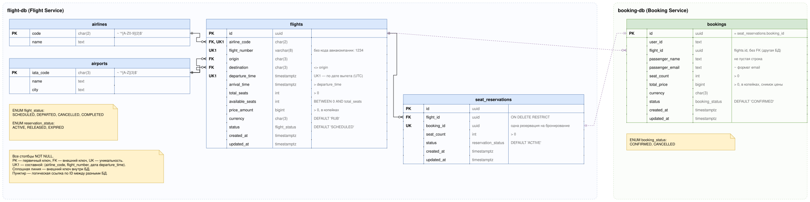

# ER-диаграмма

У каждого сервиса своя PostgreSQL:

- flight-db (Flight Service): `airlines`, `airports`, `flights`, `seat_reservations`
- booking-db (Booking Service): `bookings`

Сплошные линии — внешние ключи внутри БД, пунктирные идут между разными БД: это логические ссылки по ID, внешних ключей между базами нет

