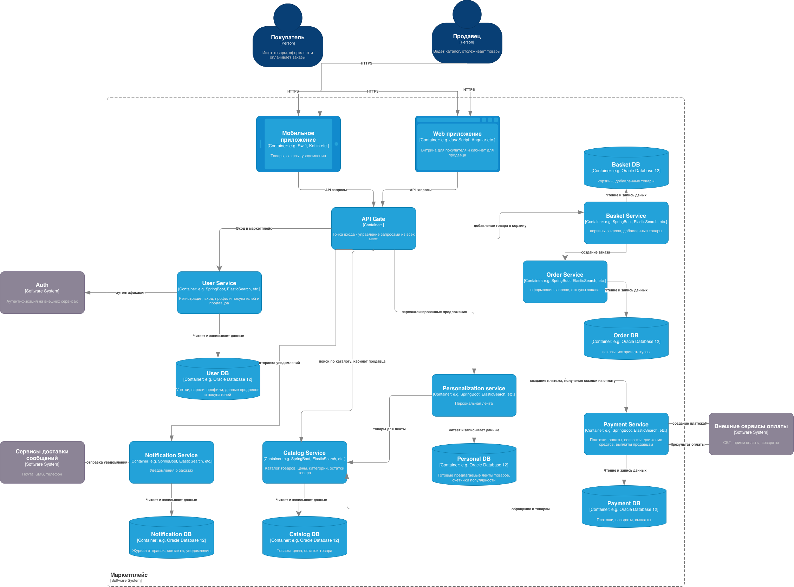

# Архитектура маркетплейса

Маркетплейс: продавцы выкладывают товары, покупатели смотрят ленту, собирают корзину, оплачивают заказ и получают уведомление.

## Диаграмма

C4, уровень Container. Файл: [docs/MarketplaceC4.drawio.svg](docs/MarketplaceC4.drawio.svg).



Снаружи покупатель, продавец и чужие системы (Auth, оплата, почта/SMS/телефон). Внутри приложения, API Gate и сервисы. У каждого сервиса своя база.

## Домены

| Домен | Зона ответсвтенности |
|---|---|
| Пользователи | Регистрация, вход, профили покупателей и продавцов |
| Каталог | Товары, цены, категории, остатки |
| Персонализация | Лента товаров для пользователя |
| Корзина | Корзины и товары, которые в них добавили |
| Заказы | Оформление заказа и статусы |
| Платежи | Оплата, возвраты, движение средств, выплаты продавцам |
| Уведомления | Сообщения о заказах |

## Распределение доменов по сервисам

| Сервис | Домен | Почему |
|---|---|---|
| API Gate | нет своего | Общий вход для сайта и телефона. Только пересылает запрос, базу не держит |
| User Service | Пользователи | Учётки отдельно от товаров и заказов. Сам вход делает внешний Auth |
| Catalog Service | Каталог | Товар, цена и остаток нужны вместе, продавец правит их в одном кабинете |
| Personalization service | Персонализация | Ленту читают чаще всего, её удобно считать отдельно от каталога |
| Basket Service | Корзина | Корзина — это ещё не заказ, только набор товаров |
| Order Service | Заказы | Заказ появляется, когда корзину оформляют, дальше у него свои статусы |
| Payment Service | Платежи | Деньги отдельно от остального |
| Notification Service | Уведомления | Отправка писем не входит в оформление заказа |

## Данные

Общей базы нет. Чужие данные сервис не читает напрямую, а запрашивает у того, кто ими владеет.

| Сервис | База | Что хранит |
|---|---|---|
| User Service | User DB | Учётки, пароли, профили покупателей и продавцов |
| Catalog Service | Catalog DB | Товары, цены, остатки |
| Personalization service | Personal DB | Готовые ленты и счётчики популярности |
| Basket Service | Basket DB | Корзины и добавленные товары |
| Order Service | Order DB | Заказы и история статусов |
| Payment Service | Payment DB | Платежи, возвраты, выплаты |
| Notification Service | Notification DB | Журнал отправок, контакты, уведомления |
| API Gate | нет | Ничего не хранит |

## Кто с кем общается

Вызовы синхронные: кто позвал, тот ждёт ответ.

| Кто | Кому | Зачем |
|---|---|---|
| Покупатель, продавец | Web и мобильное приложение | Работают с маркетплейсом, HTTPS |
| Web, мобильное приложение | API Gate | Все запросы к API |
| API Gate | User Service | Вход в маркетплейс |
| API Gate | Catalog Service | Каталог и кабинет продавца |
| API Gate | Personalization service | Персональная лента |
| API Gate | Basket Service | Добавить товар в корзину |
| API Gate | Notification Service | Отправить уведомление |
| User Service | Auth | Аутентификация во внешнем сервисе |
| User Service | User DB | Чтение и запись |
| Personalization service | Catalog Service | Взять товары для ленты |
| Personalization service | Personal DB | Чтение и запись |
| Catalog Service | Catalog DB | Чтение и запись |
| Basket Service | Basket DB | Чтение и запись |
| Order Service | Basket Service | Создать заказ из корзины |
| Order Service | Catalog Service | Обратиться к товарам |
| Order Service | Payment Service | Создать платёж и получить ссылку на оплату |
| Order Service | Order DB | Чтение и запись |
| Payment Service | Внешние сервисы оплаты | Создать оплату (СБП и т.п.) |
| Внешние сервисы оплаты | Payment Service | Вернуть результат оплаты |
| Payment Service | Payment DB | Чтение и запись |
| Notification Service | Почта, SMS, телефон | Отправить сообщение |
| Notification Service | Notification DB | Чтение и запись |

## Другие варианты

**Вариант 1. Всё в одном приложении.**  
Пользователи, каталог, корзина, заказы, оплата, лента и уведомления в одном сервисе и одной базе.
Плюсы: проще запустить. Заказ и платёж можно сохранить одной транзакцией.  
Минусы: ленту и оплату нельзя поднимать отдельно. База общая. Если ляжет отправка писем, может задеть и заказы.

**Вариант 2. Отдельный сервис на домен.**  
Это как было сделано. У каждого домена свой сервис и своя база, вход через API Gate. Корзина и заказы тоже разделены.
Плюсы: данные разделены. Оплата живёт отдельно. Ленту можно нагружать сильнее, чем заказы. Корзину можно менять, не трогая уже оформленный заказ.  
Минусы: частей больше. Чтобы оформить заказ, Order Service отдельно ходит в корзину, каталог и оплату.

Взял вариант 2. В задании разные задачи, и они ведут себя по-разному: ленту постоянно читают, платежи лучше не мешать с остальным, уведомления не нужны, чтобы купить товар. Корзину отделил от заказа, потому что товары в корзине ещё можно менять, а у заказа уже есть статус и оплата.

## Запуск

Нужен Docker.

```bash
docker compose up --build -d
curl http://localhost:8000/health
```

Ответ: `{"status":"ok","service":"catalog-service"}`.

Остановка: `docker compose down`.

Без Docker, нужен Go:

```bash
cd services/catalog-service
go run .
```
